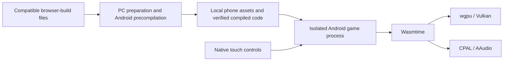

# Muguet Android

An experimental Android adaptation of [c22dev's Muguet](https://github.com/c22dev/muguet).
It runs a compatible GTA V browser build **locally on the phone**, using Wasmtime
and Vulkan. Gameplay is not streamed from a PC or cloud server.

**Current milestone:** real open-world rendering on a Realme X7 Max: the character,
city and minimap are visible, with a native mobile control overlay. This is an
early development build. Stable play, movement/vehicle actions and audible sound
have not yet been systematically verified. Earlier sessions were killed for low
memory, and world shaders still produce errors.

**Continuing the project? Start with [project-history.md](project-history.md).**
It is a self-contained handoff for a contributor or AI coding assistant, including
what worked, what failed, exact build identities and the next investigation steps.

## What works, and what remains

| Area | Evidence / current state |
| --- | --- |
| Runtime foundation | Actual shared-memory, memory64, atomic and cross-thread checks pass on the target phone. |
| Graphics foundation | Vulkan test output is visually verified on Mali-G77 MC9. |
| Real game execution | The browser-build game code executes locally through Android-targeted precompiled Wasmtime code. |
| Open-world output | A physical-device capture shows the character, city/plaza and minimap. |
| Touch controls | Floating movement stick, independent camera drag, circular action buttons and vehicle-context mappings are implemented and unit-tested; complete world-action testing is pending. |
| Audio | AAudio/mixer activity is logged; audible output has not been independently confirmed. |
| Stability | Unresolved. Earlier foreground game processes were killed with `LOW_MEMORY`; a later timed session exited after reaching the world, and its exact exit reason still needs investigation. |
| Renderer compatibility | World shaders report parsing/validation failures. Rendering a scene does not certify every shader. |
| Distribution | Source only. No proprietary game distribution or APK releases are bundled here. |

See [device validation](docs/DEVICE_VALIDATION.md) for the observations and their
limits. Presentation counters and startup rates are not sustained gameplay FPS.

## How it works



- `game-host/` adapts Muguet's runtime imports, file I/O, renderer, audio and input.
- `native/` exposes the host and independent diagnostic probes through JNI.
- `android/` contains the Java Views launcher, isolated `:game` activity and Canvas HUD.
- `scripts/` prepares content, compiles Android game code, builds the APK and installs
  files over USB. Game reads use local files; no asset server is required.

The current game session ends when its activity is backgrounded. Reopening starts
a new process; seamless background/resume is not implemented.

## Target and pinned tools

The only physically tested target is **Realme X7 Max / RMX3031**, Dimensity 1200,
Mali-G77 MC9, 8 GB RAM, Android 16/API 36. Other devices and ROMs are unverified.
The app targets ARM64, minimum API 29 and target API 36. Root is not required to
build, install or run the host.

| Component | Version |
| --- | --- |
| Rust | 1.99.0 |
| Wasmtime | 49.0.2 |
| wgpu | 30.0.1, Vulkan backend |
| CPAL | 0.18.2, Android AAudio backend |
| Java / Gradle / AGP | JDK 21 / Gradle 8.13 / AGP 8.13.2 |
| Android tools | SDK 36, Build Tools 36.0.0, NDK 28.2.13676358 |

The scripts currently assume a Linux x86-64 development host. See
[build and test instructions](docs/TESTING.md) for setup and checks.

## Build the diagnostic app

With JDK 21 and the pinned Android tools installed:

```bash
git clone --branch feat/android-game-host https://github.com/xCaptaiN09/muguet-android.git
cd muguet-android
bash scripts/setup-rust.sh
bash scripts/build-apk.sh
```

Output: `artifacts/muguet-android-game-debug.apk`. APK assembly builds the native
library automatically. Without a compiled game artifact, the diagnostic checks
remain available and game launch is disabled; a built APK alone cannot run GTA V.

## Run with compatible local game files

The proprietary browser-build executable, shader pack and game data are **not
provided by this repository**. The small host-side shader helper is part of the
licensed Muguet-derived source. Only use game files you are entitled to use.
The host expects the layout below; a normal PC installation is not a drop-in input:

```text
mirror/playgta5.com/
├── b/<build-id>/game.wasm
├── b/<build-id>/shaders/index.json
├── b/<build-id>/shaders/…
└── data/manifest.json
    … and the files named by that manifest
```

The default source location is
`~/.local/share/muguet-android/game-files/full-game-v1/mirror/playgta5.com/`.
For that layout:

```bash
python3 scripts/prepare-game.py
bash scripts/precompile-game.sh
bash scripts/build-apk.sh
bash scripts/install-game.sh
```

Preparation keeps originals separate and filters the optional `env_test` and
`verityradio` content. Precompilation produces generic Android ARM64 code. The
build embeds its SHA-256 in the APK; the app verifies its private code copy before
Wasmtime deserializes it. Never substitute an arbitrary downloaded `.cwasm`.

The measured selected content is **15.65 GB**, plus compiled code and app storage;
the original archive set is **21.19 GB**. These are different from the small APK.
Installation reuses matching staged files and normalizes asset directory access.
See [the complete game-host guide](docs/GAME_HOST.md) before using the adoption
or repair options. For controls, see [mobile controls](docs/MOBILE_CONTROLS.md).

## Contributing

The active development branch is `feat/android-game-host`. Useful next work is
renderer/shader diagnostics, memory profiling and actual world-input testing.
Start from the [handoff's next steps](project-history.md#where-to-continue).

- Preserve the pinned toolchain, code-digest verification and isolated process
  lifecycle unless a change explicitly addresses and tests those boundaries.
- Keep original assets immutable: prepared files may be hardlinked to the originals.
- Use reproducible logs and screenshots to support device claims. Share sanitized
  evidence; keep credentials, device identifiers, saves and raw captures private.
- Keep game files and compiled game artifacts outside Git. The repository's license
  does not grant rights to Rockstar's game data.
- Update `project-history.md` when evidence, important fixes or the resume point changes.

Local checks and their prerequisites are in [TESTING.md](docs/TESTING.md).
There is no requirement to reproduce game content to work on the synthetic tests.

## License and credits

Project source is licensed under **GPL-3.0-or-later**; see [LICENSE](LICENSE).
This follows Muguet's upstream license. Copyright/attribution and dependency
boundaries are recorded in [NOTICE](NOTICE) and
[Muguet provenance](third_party/muguet/UPSTREAM.md).

Credit to **Constantin Clerc / c22dev** for Muguet and its native host approach.
The imported source is pinned to
`ddcc54f44ae2a21b8c6e43ec1c925b55b352ffbd`. Android adaptation and integration are
maintained by [xCaptaiN09](https://github.com/xCaptaiN09).

This is an unofficial community project, unaffiliated with Rockstar Games,
Take-Two Interactive or Muguet's author. GTA V and its game assets belong to their
respective rights holders and are not licensed or distributed with this project.

## Further reading

- [Project history and AI handoff](project-history.md)
- [Game host and installation](docs/GAME_HOST.md)
- [Device validation](docs/DEVICE_VALIDATION.md)
- [Roadmap](docs/ROADMAP.md)
- [Upstream audit](docs/PORTING_AUDIT.md)
- [Asset delivery directions](docs/ASSET_DELIVERY.md)
